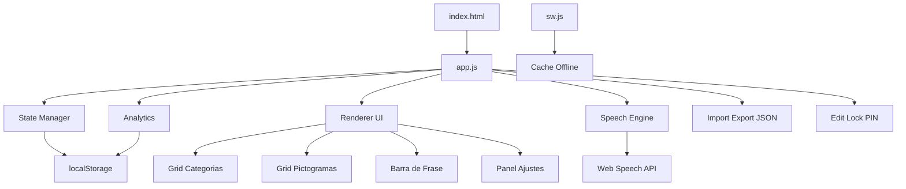
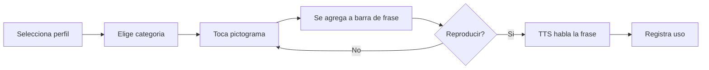

# Plan de Arquitectura — Tablilla SAAC

## 1. Objetivo

Construir una **tablilla de comunicación aumentativa y alternativa (SAAC/AAC)** para niños sin lenguaje oral o con dificultades de comunicación. Debe ser profesional, accesible, 100% offline y usable en tablet y PC.

## 2. Decisiones clave (confirmadas)

| Decisión | Elección |
|---|---|
| Plataforma | Web app vanilla (HTML/CSS/JS), sin dependencias |
| Alcance MVP | Completo: perfiles, edición, analítica, import/export, bloqueo |
| Pictogramas | Emojis nativos del sistema (offline, sin assets externos) |
| Persistencia | `localStorage` |
| Voz | Web Speech API (`speechSynthesis`) |
| Offline | PWA con `manifest.json` + service worker |

## 3. Estructura de archivos

```
Tablilla/
├── index.html
├── styles.css
├── app.js
├── manifest.json
├── sw.js
├── data/
│   └── pictogramas.js      # Dataset inicial por categorías
├── assets/
│   └── icons/              # Iconos PWA
├── plans/
│   └── plan-tablilla-saac.md
└── README.md
```

## 4. Modelo de datos (localStorage)

```js
// Clave: "saac_state"
{
  version: 1,
  settings: {
    voiceURI: null,
    rate: 1.0,
    pitch: 1.0,
    highContrast: false,
    pictoSize: "md",        // sm | md | lg
    editLocked: true,
    pinHash: null,          // hash simple del PIN de terapeuta
    activeProfileId: "p1"
  },
  profiles: [
    {
      id: "p1",
      name: "Niño 1",
      avatar: "🧒",
      boards: [ /* ver abajo */ ],
      frequentPhrases: [ { id, text, pictos: [] } ]
    }
  ],
  usageLog: [
    { ts, profileId, type: "picto"|"phrase", label, category }
  ]
}
```

### Tablero (board)
```js
{
  id: "b1",
  name: "Necesidades",
  icon: "🙋",
  pictos: [
    { id: "x1", emoji: "💧", label: "Agua", speak: "Quiero agua" }
  ]
}
```

## 5. Arquitectura de la aplicación



### Módulos lógicos dentro de `app.js`
- **State**: carga/guarda estado, migraciones de versión.
- **Renderer**: pinta categorías, pictogramas, barra de frase, ajustes.
- **Speech**: `speak(text)`, lista de voces, control de velocidad.
- **Phrases**: guardar/reproducir/eliminar frases frecuentes.
- **Profiles**: CRUD de perfiles.
- **Editor**: CRUD de pictogramas y tableros.
- **Accessibility**: alto contraste, tamaño, foco/teclado.
- **Lock**: PIN de terapeuta para bloquear edición.
- **Analytics**: registro de eventos + export CSV.
- **IO**: import/export JSON.

## 6. Flujo de uso principal



## 7. Accesibilidad (criterios)

- Objetivos táctiles mínimos de 64x64 px.
- Contraste AA/AAA en modo alto contraste.
- Navegación completa por teclado (Tab/Enter/Espacio).
- `aria-label` en cada pictograma con su etiqueta.
- `prefers-reduced-motion` respetado.
- Texto escalable y tamaño de pictograma ajustable.

## 8. Seguridad y privacidad

- Todo local: sin servidores, sin telemetría externa.
- PIN de terapeuta con hash simple (no criptográfico, suficiente para bloqueo de UI).
- Export/import JSON para respaldo manual.

## 9. Criterios de aceptación del MVP

1. Funciona offline tras primera carga.
2. Se puede construir y reproducir una frase con TTS.
3. Se pueden crear perfiles y tableros personalizados.
4. La edición se bloquea con PIN.
5. Se registra el uso y se exporta a CSV.
6. Se importan/exportan tableros en JSON.
7. Responsive y accesible en tablet y PC.
